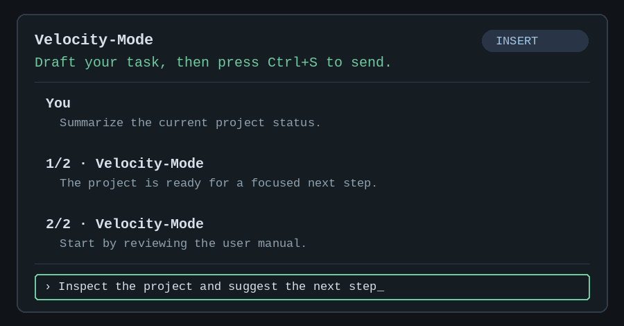

# Velocity-Mode

Velocity-Mode (`vmode`) is a Python 3.11+ coding-agent CLI with a
keyboard-first, Vim-inspired terminal interface. Start with a prompt, review
each proposed workspace action, and keep your session locally resumable.

## Start here

1. Install VMode.
2. [Choose a provider and set its credential](docs/USER_MANUAL.md#choose-a-provider).
3. Run `vmode`, type a task, and press `Ctrl+S`.

The [user manual](docs/USER_MANUAL.md) introduces one capability at a time:
starting a session, navigating with Vim keys, choosing a provider, approving
work, and resuming later.



*Vim-style navigation in the VMode terminal: `Esc` enters Normal mode, `Tab`
moves between the prompt and results, and `[`/`]` select a response.*

### Learn at your pace

| When you are ready to… | Read |
| --- | --- |
| Send your first task and attach a file | [Start](docs/USER_MANUAL.md#start) |
| Move, search, copy, and save with Vim keys | [Prompt and results](docs/USER_MANUAL.md#prompt-and-results) |
| Configure or switch models | [Choose a provider](docs/USER_MANUAL.md#choose-a-provider) |
| Review proposed writes and commands | [Approvals and safety](docs/USER_MANUAL.md#approvals-and-safety) |
| Resume or remove a local session | [Sessions](docs/USER_MANUAL.md#sessions) |
| Explore provider, workspace, and development reference | [Advanced reference](docs/USER_MANUAL.md#advanced-reference) |

## Why Velocity-Mode

- **Vim-like, minimalist interaction.** Keep your hands on the keyboard while
  editing prompts and browsing results.
- **Visible, deliberate work.** Review streamed responses and approve writes,
  commands, Git staging, and commits before they run.
- **Flexible and recoverable.** Choose a supported provider, switch an idle
  session when needed, and resume local sessions after an interruption.

## Install

On Linux, install the latest version from the public GitHub repository:

```sh
curl -fsSL https://raw.githubusercontent.com/josnin/velocity-mode/main/install.sh \
  -o install.sh
less install.sh
sh install.sh
```

The installer requires Python 3.11+ and Git, creates an isolated environment,
and adds `vmode` to `~/.local/bin`. It does not use `sudo` or modify shell
startup files. Add `~/.local/bin` to your `PATH` using your shell's normal
configuration if needed.

## First session

```sh
vmode
```

Write a task and press `Ctrl+S`. Start VMode without `--exec` for work that
may need write or command approval.

For the complete reference, including provider-specific setup, workspace
search, limits, source installation, skills, and tests, read the
[user manual](docs/USER_MANUAL.md).
