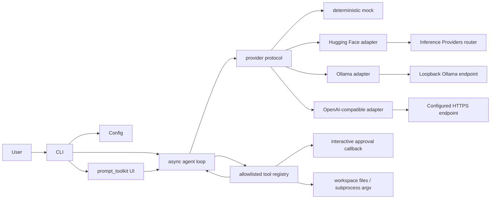

# Architecture

Velocity-Mode is a Python 3.11+ asynchronous CLI. The prompt UI, agent loop, provider
protocol, domain messages, and tool registry are separate modules; provider
HTTP/SSE parsing remains inside each adapter. The live adapters support Hugging
Face, local Ollama, and generic OpenAI Chat Completions-compatible endpoints.

## Modules and data flow

| Module | Responsibility |
| --- | --- |
| `cli.py` | Parse options, provide the interactive prompt and completion, approvals, and exit codes |
| `config.py` | Load TOML/environment/CLI settings and validate bounds |
| `protocol.py` | Provider-independent messages, tool calls, usage, events, errors, and limits |
| `providers.py` | `Provider` protocol, deterministic test provider, Hugging Face, loopback-only Ollama, and generic OpenAI-compatible HTTP/SSE adapters |
| `agent.py` | Bounded provider → tool → tool-result → provider loop and structured history |
| `tools.py` | Fixed tool definitions, workspace path checks, file references, approval and subprocess execution |

Each request appends the user task to ordered history. Root-level `AGENTS.md`
and `SKILLS.md` instructions are added to the system prompt when present,
subject to size/encoding checks and an untrusted-instructions boundary.
Workspace skill files under `.vmode/skills/*.md` are discovered separately.
Their TOML metadata is filtered deterministically from the task; tied matches
use a bounded, provider-independent JSON selector request. Selected files are
snapshotted by ID, declared version, and SHA-256 hash for the active task and
are appended to that task's user context. The system prompt and tool schema
remain unchanged, so the stable provider prefix is preserved; catalog changes
take effect on the next task.
Explicit `@file` references are resolved and appended as context before the
request. Assistant tool calls are validated and executed by the fixed
registry; results retain role `tool` and their matching `tool_call_id`. The
next provider call receives the complete history. The adapters translate
these normalized messages to Chat Completions and incrementally decode SSE;
the UI displays provider-independent text/activity/usage/error events.

Interactive model work runs as an asyncio task beside `prompt_toolkit`'s
asynchronous input. It does not make blocking network calls on the terminal
input path. Subprocess tools use asyncio subprocess APIs. Provider cancellation
propagates through task cancellation. The loop bounds request iterations,
wall-clock time, output characters, and tool-result size.

## Intentional boundaries

The `mock`, `huggingface`, `ollama`, and `openai-compatible` providers are supported.
The mock is deterministic and offline; its `read-file` scenario demonstrates
the full tool cycle. The live adapters implement streaming OpenAI Chat
Completions only. Responses API and separate Inference Endpoint protocols are
not implemented; compatibility can vary between vendors.
Ollama uses the same normalized Chat Completions stream but accepts HTTP only
for `localhost` or a loopback IP address; it requires no API key and rejects
remote hosts.

Provider capabilities explicitly report streaming and tool-call support.
Hugging Face tool calling is enabled by default; for generic compatible
providers it must be enabled explicitly through configuration or CLI. Enabling
it sends tool definitions but does not prove the selected model supports or
reliably follows them. The runtime validates calls and bounds repeated
requests, but does not claim universal function-calling compatibility.

The system prompt and tool schema remain stable across turns to preserve a
cacheable request prefix where the selected inference backend supports prefix
caching. Prior conversation is capped to four turns and 60,000 serialized
characters; truncation removes complete oldest turns rather than breaking a
tool-call/result group. The active turn and explicit current file references
remain intact. Provider-reported cached-input usage is shown when available;
no cache hit or cost saving is assumed.

`run_command` uses an argv list (not a shell string), is restricted to the
workspace working directory, has output and timeout limits, and requires
approval. This is not a sandbox: approved processes inherit the current
user's permissions/environment. Keep provider HTTP/JSON, prompt rendering,
workspace authorization, and agent orchestration in their respective
boundaries.
